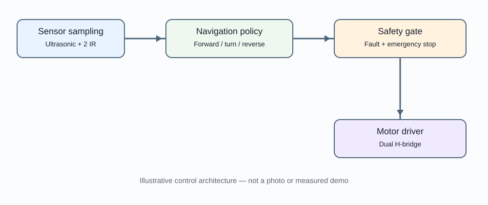

# ScoutNav — Reactive Autonomous Rover

Firmware for a two-wheel differential-drive rover using a front ultrasonic sensor and two digital IR obstacle sensors. Navigation policy is isolated from motor-driver I/O so it can be tested independently.

**Hardware integration is not claimed as verified.** Select a dual H-bridge based on motor voltage and stall current. TB6612FNG is appropriate only if its current and thermal limits suit your motors; otherwise select a higher-rated driver.

## Control architecture preview



This is an architecture illustration, not a physical rover demonstration. Add a real short video/GIF and photos after the rover has been assembled and tested.

## Hardware
- ESP32 development board
- 2WD chassis and two DC gear motors
- Dual H-bridge driver rated for stall current
- HC-SR04 or 3.3 V-safe ultrasonic sensor
- Two digital IR obstacle modules
- Suitable battery, fuse, switch and decoupling
- Optional servo for later sensor scanning

## Safety and pin configuration
See `include/board_config.h` and `docs/wiring.md`. The HC-SR04 ECHO pin is typically 5 V; use a calculated divider or level shifter before connecting to ESP32. Verify IR output voltage and active polarity. Default pins are examples.

## Behavior
- `FORWARD`: clear front range and side sensors.
- `TURN_LEFT` / `TURN_RIGHT`: side obstacle detected.
- `REVERSE`: front range below threshold.
- `FAULT`: invalid or stale ultrasonic measurement.
- Serial `e`: latched emergency stop; `r`: reset.

This is reactive obstacle avoidance, not mapping, SLAM or robust navigation. The local firmware retains stop behavior even if a future ROS/network connection fails.

## Build
Install Arduino ESP32 core. Open `firmware/scoutnav/scoutnav.ino`, inspect pins, driver polarity and Arduino core version, then compile for the exact board. The adapter targets a TB6612FNG-style interface. Adapt `MotorDriver` for other drivers and repeat tests.

## Test
```bash
python3 -m unittest discover -s tests -v
```
Host tests validate policy logic, not physical sensor accuracy or safety. First motor tests should be with wheels lifted, low PWM, current-limited supply and an accessible power disconnect.

## Limitations
No wheel encoders, closed-loop speed, localization, map or global planner. IR sensors vary with lighting and surface. Ultrasonic sensing can fail on angled, narrow or soft objects.
